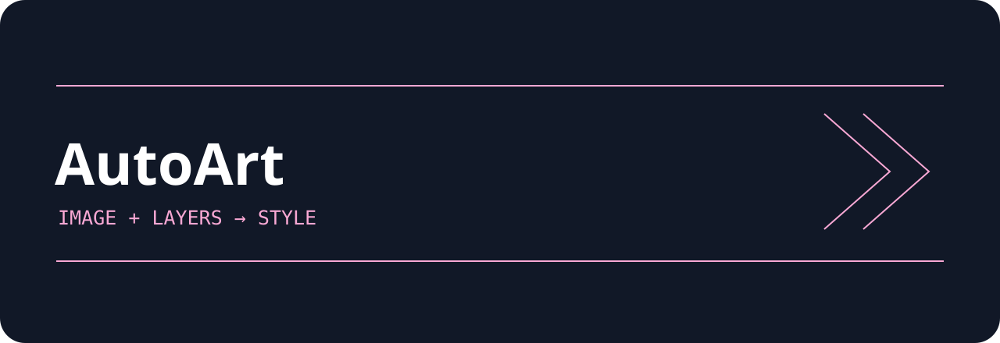
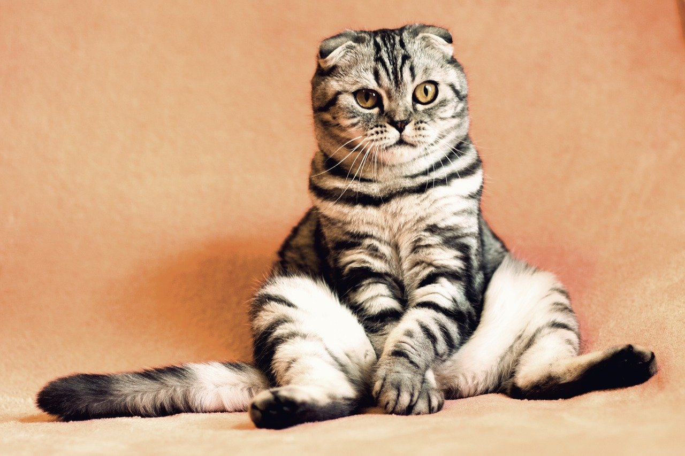
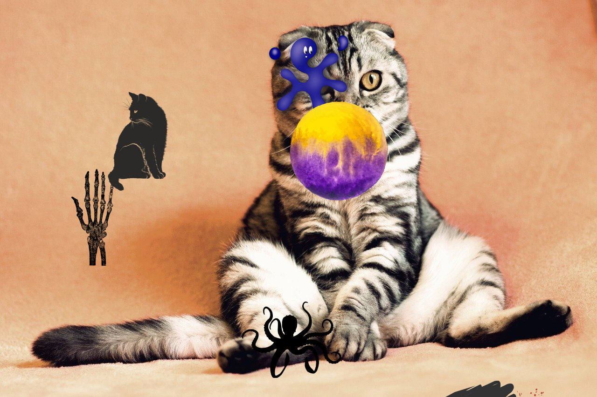
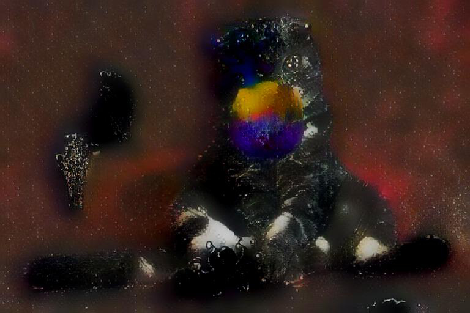

# AutoArt

Generate a collage from a Pixabay search: add stickers and an underlay, then apply a reference style through DeepAI.

## Table of Contents

- [Showcase](#showcase)
- [Setup](#setup)
- [Technologies](#technologies)

## Showcase

| Search image | With stickers | Reference style | Result |
| --- | --- | --- | --- |
|  |  |  |  |

Included images are from [Pixabay](https://pixabay.com/) and subject to the [Pixabay Content License](https://pixabay.com/service/terms/#license).

## Setup

From the repository root, review `requirements.txt`. The original environment used OpenCV contrib 4.5.1.48 and NumPy 1.18.5. Keep your Pixabay API key in a local `pixabay_key.txt`; do not commit a live key. Run `python3 generate.py`. Customize `Overlays/`, `Underlays/`, and `Styles/` to change the results. External endpoints have not been verified.

## Technologies

- [Python](https://www.python.org/)
- [OpenCV contrib](https://pypi.org/project/opencv-contrib-python/)
- [NumPy](https://numpy.org/)
- [Pixabay API](https://pixabay.com/api/docs/)
- [DeepAI Fast Style Transfer](https://deepai.org/machine-learning-model/fast-style-transfer)
